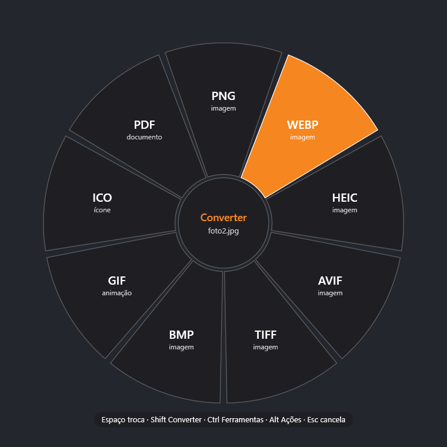
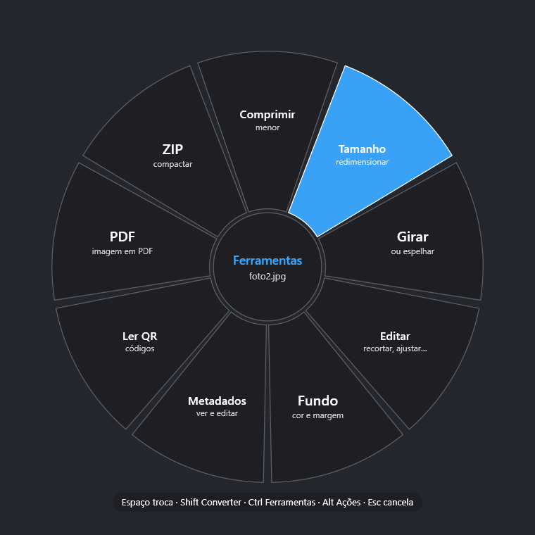
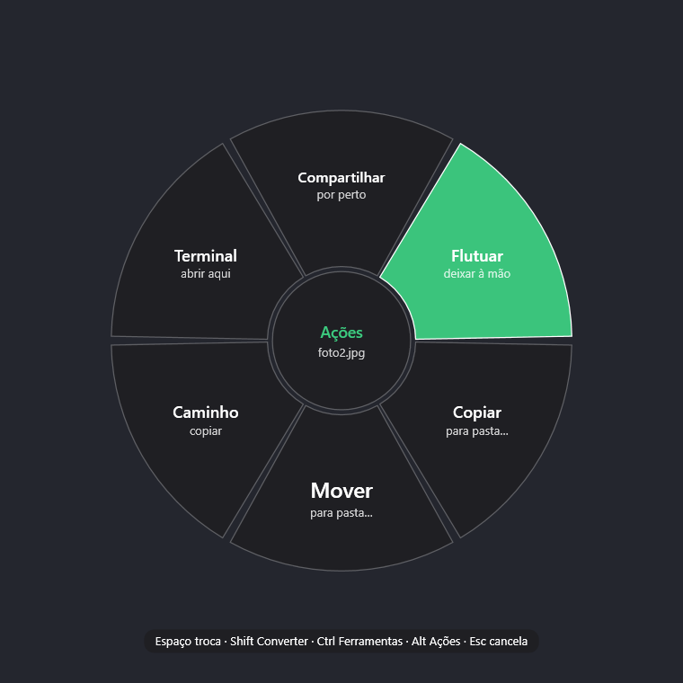

[Português (Brasil)](README.md) · [English](README.en.md) · [Español](README.es.md) · [Français](README.fr.md) · [Deutsch](README.de.md) · [Italiano](README.it.md) · [日本語](README.ja.md) · **한국어** · [简体中文](README.zh-CN.md) · [Русский](README.ru.md) · [Polski](README.pl.md) · [हिन्दी](README.hi.md) · [العربية](README.ar.md)

<p align="center"></p>

<h1 align="center">Mexerica</h1>

<p align="center">프로그램을 열지 않고 파일을 변환하고 편집하세요. 파일을 끌고 <b>스페이스</b>를 누른 다음 원하는 항목 위에 놓으면 됩니다.</p>

<p align="center">
  
  
  
</p>

Mexerica는 Mac용 [Tangerine](https://tangerineformac.com)의 아이디어를 Windows에서 구현한 프로그램입니다. 작업 표시줄의 알림 영역에 머뭅니다. 파일을 하나 이상 끌고 마우스를 놓지 않은 채 스페이스를 누르면, 커서 주위에 휠이 나타나 그 파일로 할 수 있는 일을 보여 줍니다. 결과는 원본 옆에 저장되며 원본은 절대 바뀌지 않습니다. 변환은 내 컴퓨터 안에서 이루어지고, 파일이 인터넷으로 전송되지 않습니다. Mexerica가 인터넷을 쓰는 것은 새 버전을 확인할 때와 웹사이트에서 끌어온 것을 내려받을 때뿐입니다.

**버전 1.1의 새 기능:** 훨씬 많은 형식 (RAW, PSD, Kindle, Outlook, 자막, 글꼴, 3D, 지도, CAD, ISO, DMG 등), LibreOffice 없이 Word, Excel, PowerPoint 변환, 자동으로 변환하는 폴더, 최근 변환, 사전 설정을 넣을 수 있는 휠 꾸미기, 브라우저에서 바로 끌어오기, 13개 언어, 명령줄, 업데이트 알림. [기능별 사용법](#기능과-위치)을 확인하세요.

**언어:** Mexerica는 포르투갈어로 열립니다. 한국어로 바꾸려면 **Configurações** (설정)를 열고 **Idioma** (언어)를 고르세요.

## 사용법

| 동작 | 방법 |
|---|---|
| 휠 열기 | 파일을 끌고, 놓지 않은 채 **스페이스**를 누름 |
| 휠 바꾸기 | **스페이스**를 다시 누르거나, **Shift** (변환), **Ctrl** (도구), **Alt** (작업) |
| 고르기 | 항목 위에 파일을 놓거나, **화살표 키**와 **Enter** 사용 |
| 취소 | **Esc** |
| 키보드로 | 파일 탐색기나 바탕 화면에서 파일을 선택하고 **Ctrl + Shift + 스페이스**를 누름 |
| 터치스크린 | 손가락을 잠깐 가만히 대고 있다가 끌기 |
| 마우스 오른쪽 버튼 | 파일을 선택하고 마우스 오른쪽 버튼을 눌러 **Mexerica** 하위 메뉴 사용 (Windows 11에서는 "더 많은 옵션 보기" 안에 있음) |

여러 파일을 동시에 처리합니다. 동영상 형식 (MKV, MOV, MP4)만 바꿀 때는 가능하면 다시 인코딩하지 않아서 몇 초 만에 화질 손실 없이 끝납니다. 다시 인코딩해야 할 때는 그래픽 카드 (NVIDIA, Intel, AMD)가 있으면 그것을 사용합니다.

키, 품질, 저장 폴더는 설정에서 바꿉니다 (알림 영역 아이콘을 두 번 클릭하거나 Mexerica를 다시 실행).

## 할 수 있는 일

**변환**
- 이미지: JPG, PNG, WebP, HEIC, AVIF, JPEG XL, JPEG 2000, TIFF, BMP, GIF, APNG, ICO, ICNS, PSD, TGA, DDS, QOI, PCX, SVG (이미지를 벡터화), PDF
- 입력만 되는 이미지: 카메라 RAW (CR2, CR3, NEF, ARW, DNG 등), PSB, DICOM, EXR, HDR, XCF, JPEG XR, CUR, PPM, EPS, PS, AI, EMF, WMF, SVGZ
- 오디오: MP3, M4A (AAC와 ALAC), WAV, FLAC, OGG, Opus, AIFF, WMA, WavPack, TTA, AC3, E-AC3, W64 (APE, DSF, DFF, DTS, AMR, MKA, CAF, AU, MPC도 읽음)
- 동영상: MP4 (H.264, HEVC, AV1), MOV, MKV, WebM, AVI, WMV, 움직이는 GIF와 WebP, APNG, MP4 720p, MP3 (VOB, OGV, MXF, ASF, RM/RMVB, DivX, F4V도 읽음)
- iPhone의 Live Photo와 Android의 Motion Photo: 사진에서 동영상을 꺼냄
- PDF를 DOCX, PPTX, XLSX, EPUB, TXT, Markdown, JPG, PNG로 (모든 페이지)
- Office 문서, 스프레드시트, 프레젠테이션 (LibreOffice가 있든 없든), HWP와 HWPX, HTML, Markdown, RTF, ODT
- 전자책: EPUB, KEPUB (Kobo), MOBI, AZW, AZW3, FB2, HTMLZ, TXTZ. 만화 CBZ, CBR, CB7, CBT를 PDF와 EPUB로
- 이메일 EML과 MSG (Outlook)를 HTML, TXT, PDF로. 첨부 파일은 ZIP에 담음
- 자막: SRT, ASS/SSA, VTT, SMI, LRC, TTML, SUB, SCC. 오래된 파일의 악센트 문자도 그대로 보존
- 데이터: JSON, JSONL, YAML, TOML, XML, CSV, TSV끼리 서로 변환. vCard 연락처를 스프레드시트로, 그리고 다시 vCard로
- 글꼴: TTF, OTF, WOFF, WOFF2, EOT
- 3D 모델: GLB, glTF, STL, OBJ, 3MF, PLY (FBX는 입력만) 및 이미지 미리 보기
- 지도: GeoJSON, KML, KMZ, GPX, Shapefile, 좌표가 들어 있는 CSV
- CAD: DWG와 DXF끼리, 그리고 PDF, SVG, 이미지로. SVG를 DXF와 DWG로
- 압축 파일: ZIP, 7Z, TAR, TAR.GZ, TAR.XZ, TAR.BZ2 (RAR, ISO, CAB, DMG, WIM, ARJ, LZH, CPIO, RPM, DEB, ZST, LZ, LZMA, Z도 읽음)

휠에는 그 파일에 맞는 항목만 나옵니다. 소리 없는 동영상에는 MP3가, 정지 사진에는 APNG가, 연락처가 아닌 스프레드시트에는 vCard가 나오지 않습니다.

**도구**
- 이미지, 동영상, 오디오, PDF 압축 (단계별, 비율별 또는 정확한 크기로)
- 사진 편집기: 자르기, 색 조정, 화살표, 사각형, 펜, 글자, 가리기 (검정, 흐림, 모자이크)
- 이미지 배경과 여백, 여러 사진 콜라주, 이미지를 PDF로, 흑백, QR 코드 읽기
- 메타데이터: 전부 보기, 제목과 작성자 등 편집, 위치 정보나 전부 지우기
- 동영상: 구간 자르기, 화면 자르기, 속도, 나누기, 장면 하나 또는 전부 저장, 오디오와 자막 꺼내기, 회전, 해상도 바꾸기, 소리 없애기, 합치기
- 오디오: 구간 자르기, 볼륨 맞추기, 구간에 삐 소리 넣기, 모노와 스테레오, 속도, 나누기, 합치기
- PDF: 페이지 정리 (순서 바꾸기, 회전, 삭제), 나누기, 합치기, 제대로 가리기 (가린 글자가 완전히 사라짐)
- 자막: 시간을 늦추거나 당기기. 글꼴: 견본 시트. 압축 파일: 풀기와 무결성 검사

**작업**: 공유 (Windows 근거리 공유), 화면에 띄워 두기, 폴더로 복사하거나 이동, 경로 복사, 그 폴더에서 터미널 열기.

## 기능과 위치

설정은 시계 근처에 있는 Mexerica 아이콘을 두 번 클릭하거나, 시작 메뉴에서 Mexerica를 다시 실행하면 열립니다. 나머지는 아이콘 메뉴 (마우스 오른쪽 버튼)에 있습니다.

| 기능 | 용도 | 위치 |
|---|---|---|
| **감시 폴더** | 폴더에 들어오는 것을 모두 자동으로 변환합니다. 예: 다운로드에 들어오는 HEIC 사진을 모두 JPG로 | 설정 → 결과 → 감시 폴더 → **선택…** → **폴더 추가…**, 형식을 고르고 저장 |
| **최근 변환** | 한 작업의 목록. 검색, 미리 보기 그림, 열기 / 다른 프로그램으로 열기 / 폴더에서 보기 버튼이 있음 | 아이콘에서 마우스 오른쪽 버튼 → **최근 변환…** |
| **휠 사용자 정의** | 쓰지 않는 항목을 숨기고 항목 순서를 바꿈 | 설정 → 휠 모양 → **사용자 정의…** |
| **사전 설정** | 휠에 나만의 항목을 추가. 예: "웹" = JPG, 품질 80, 최대 1600 px, 위치 정보 없음. 또는 "가벼운 MP3" | 같은 창에서 **새로운 사전 설정…** |
| **테마와 투명도** | 밝게, 어둡게 또는 Windows와 같게, 투명도도 조절 | 설정 → 휠 모양 → 테마와 불투명도 |
| **여러 면이 있는 휠** | 항목이 많으면 휠이 여러 면으로 나뉩니다 | 휠이 열린 상태에서 **Tab** 또는 마우스 휠 |
| **브라우저에서 바로** | 웹사이트의 이미지나 파일을 먼저 내려받지 않고 변환 | 사이트의 이미지나 링크를 끌고 **스페이스**를 누른 뒤 항목 위에 놓기. 파일은 다운로드 폴더에 저장됨 |
| **언어** | 포르투갈어, 영어, 스페인어, 프랑스어, 독일어, 이탈리아어, 일본어, 한국어, 중국어, 러시아어, 폴란드어, 힌디어, 아랍어. Mexerica는 포르투갈어로 열립니다 | **Configurações** (설정) → **Idioma** (언어) |
| **업데이트** | 새 버전이 나오면 시계 근처에 알림이 뜨고, 한 번 클릭하면 업데이트됩니다. 내려받은 파일은 설치 전에 확인 (SHA-256)합니다 | 설정 → 업데이트 (지금 확인 또는 알림 끄기) |
| **명령줄** | 명령 프롬프트나 스크립트에서 변환 | [명령줄](#명령줄) 참고 |

바로 가기 (.lnk)는 실제 파일을 찾아가서 처리하고, 빈 파일은 처리하기 전에 알려 줍니다.

## 설치

1. **Releases** 페이지 (이 페이지 오른쪽)에서 `Mexerica-<versão>-instalador.exe`를 내려받습니다.
2. 내려받은 파일을 열고 끝날 때까지 **Avançar** (다음)를 클릭합니다. 설치 프로그램은 포르투갈어로 되어 있습니다. 관리자 비밀번호는 필요 없습니다.
3. Windows에 "Windows의 PC 보호"가 표시되면 **추가 정보**를 클릭한 다음 **실행**을 클릭합니다. 이 경고는 설치 프로그램에 유료 디지털 서명이 없어서 나오는 것이지, 문제가 있어서가 아닙니다.

설치가 끝나면 사용법을 알려 주는 창이 열립니다. Mexerica는 컴퓨터를 켤 때 자동으로 실행됩니다 (알림 영역 메뉴에서 끌 수 있음). 제거하려면: **설정 → 앱 → 설치된 앱 → Mexerica → 제거**. 마우스 오른쪽 버튼 메뉴와 설정도 함께 지워집니다.

요구 사항: Windows 10 (버전 2004 이상) 또는 Windows 11, 64비트. 따로 설치할 것은 없습니다. [LibreOffice](https://pt-br.libreoffice.org)는 선택 사항입니다. 있으면 문서, 스프레드시트, 프레젠테이션이 원본에 더 가깝게 변환됩니다. 없으면 설치 프로그램이 권하고, 거절해도 Mexerica가 직접 변환합니다.

## 명령줄

설치할 때 **Usar o comando "mexerica" no Prompt de Comando e no PowerShell** (명령 프롬프트와 PowerShell에서 "mexerica" 명령 사용)에 체크하면 어느 폴더에서나 `mexerica`를 부를 수 있습니다.

```powershell
mexerica converter *.heic --para jpg                      # 모두 JPG로 변환해 원본 옆에 저장
mexerica converter video.mov --para mp4 -o D:\Saida      # 저장 폴더 지정
mexerica opcoes planilha.xlsx                             # 그 파일로 할 수 있는 일 목록
mexerica ferramenta Comprimir foto.jpg --p modo=pct --p pct=50
mexerica vigiar D:\Fotos --para webp --subpastas          # Ctrl+C를 누를 때까지 들어오는 것을 변환
```

종료 코드는 모두 성공하면 0, 실패한 파일이 있으면 1, 매개변수에 오류가 있으면 2입니다.

## 빌드

[.NET 8 SDK](https://dotnet.microsoft.com/download/dotnet/8.0)가 필요합니다.

```powershell
powershell -ExecutionPolicy Bypass -File scripts\baixar-ferramentas.ps1   # ffmpeg, Ghostscript, ExifTool, qpdf, 7-Zip, lzip, rhwp를 tools\에
powershell -ExecutionPolicy Bypass -File scripts\compilar-menu.ps1        # 마우스 오른쪽 버튼 확장 (C++. llvm-mingw는 자동으로 내려받음)
dotnet build src -c Release                                             # 테스트용
powershell -ExecutionPolicy Bypass -File scripts\publicar.ps1           # 완성본을 dist\에, Release용 zip도 만듦
powershell -ExecutionPolicy Bypass -File testes\rodar.ps1               # 화면 없는 테스트 모음
powershell -ExecutionPolicy Bypass -File testes\amostras-externas.ps1   # 공개 자료실에서 내려받은 실제 파일로 드문 형식 테스트
```

화면에 새 문구를 넣으면 번역이 필요합니다. `python scripts\extrair-textos.py --check`로 빠진 것을 확인하고, `python scripts\gerar-traducoes.py`로 `src\Idiomas`에 초안을 만듭니다. 초안은 꼭 검토해야 합니다.

프로그램 자체에도 화면 없는 테스트 모드가 있습니다.

```powershell
Mexerica.exe --executar <Convert|Tools> <opção|*> relatorio.txt [--p chave=valor ...] arquivos...
```

## 라이선스

코드는 MIT 라이선스입니다. 사용한 외부 라이브러리와 프로그램은 각각의 라이선스와 함께 [THIRD-PARTY-NOTICES.md](THIRD-PARTY-NOTICES.md)에 정리되어 있습니다.
